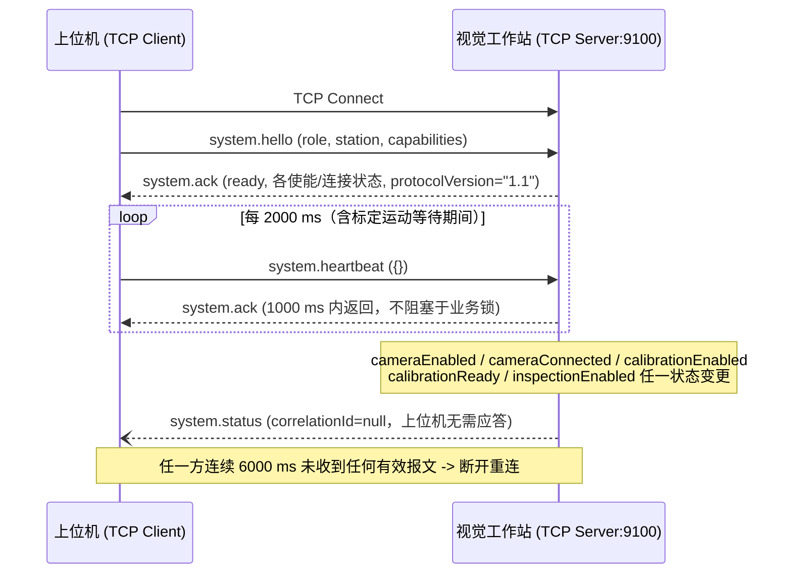
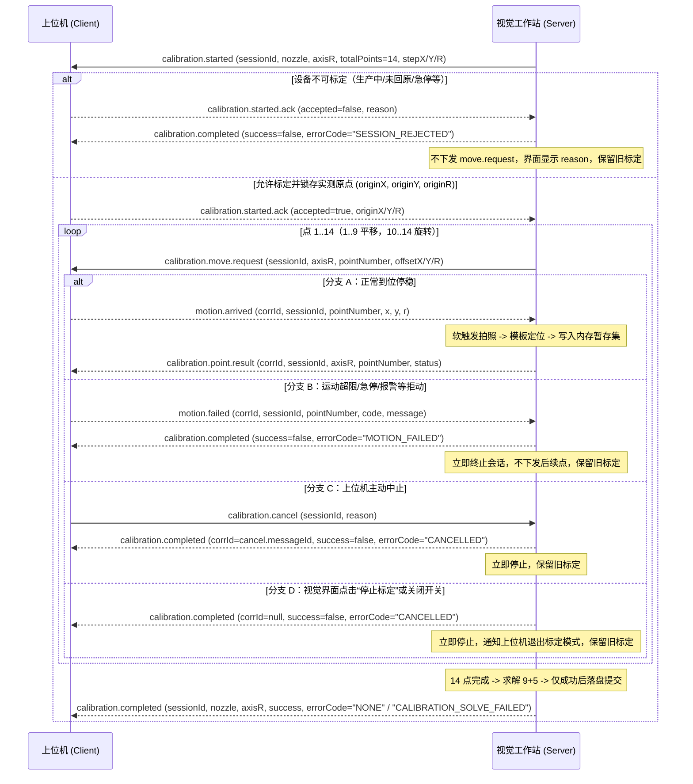
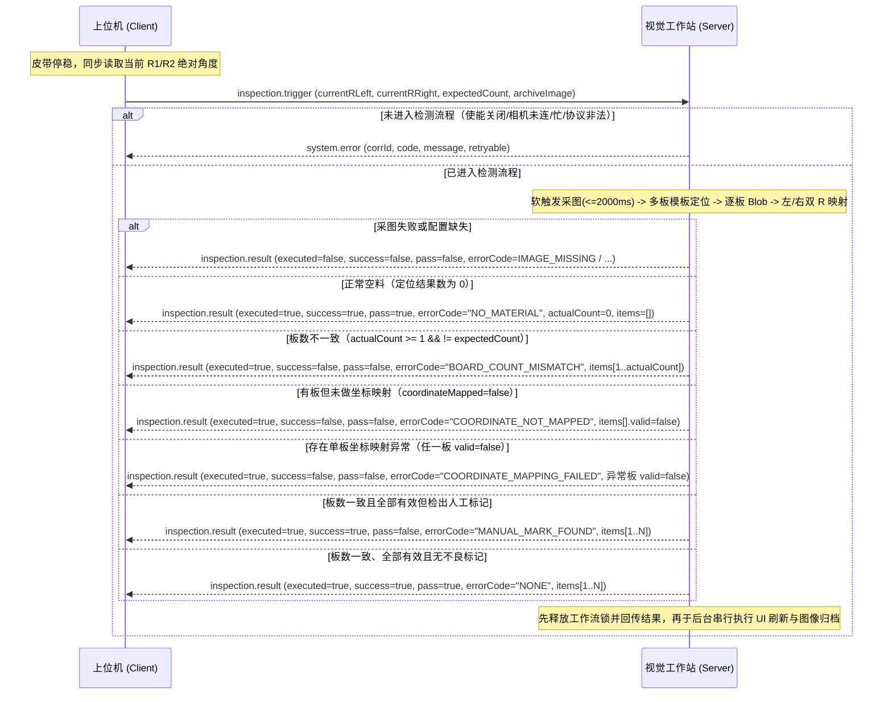
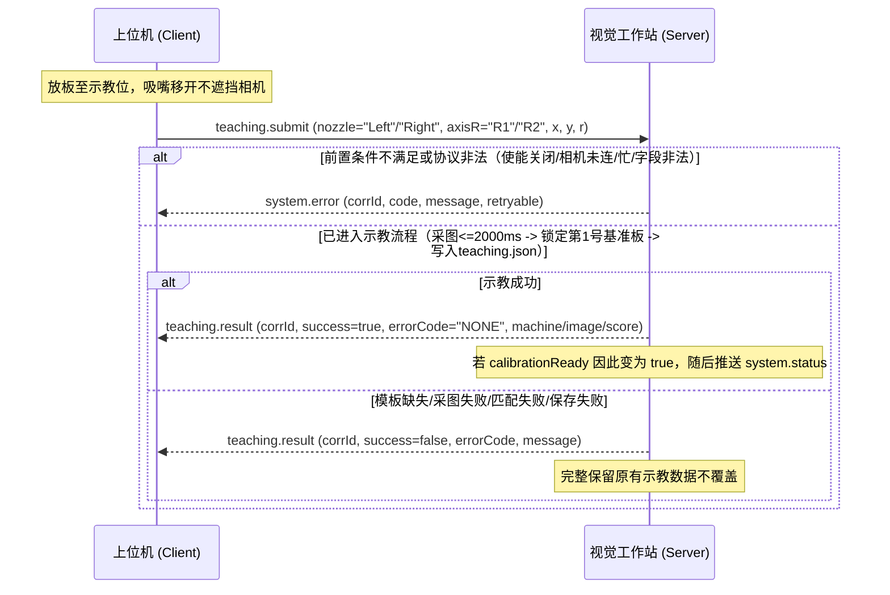

# ZM910A 视觉工作站与上位机 TCP 通讯协议规范（v1.1 完整版）

| 项目 | 内容 |
| --- | --- |
| **协议名称** | ZM910A 视觉工作站与上位机 TCP 通讯协议规范 |
| **协议版本** | `v1.1`（唯一正式实施版本，纯 JSON 协议；已并入上位机 3 项确认补全） |
| **发布日期** | 2026-11-23 |
| **适用机型** | ZM910A PCB 移栽龙门（共用 X/Y 轴 + 独立左吸嘴 R1 / 右吸嘴 R2） |
| **通讯角色** | 视觉工作站 = TCP Server（默认 `0.0.0.0:9100`）；上位机 = TCP Client |

---

## 1. 系统拓扑与职责边界

ZM910A 移栽龙门具备**左、右两个独立吸嘴，共用一套 X/Y 轴，各自配备一根独立旋转轴**（`Left` 对应 `R1`，`Right` 对应 `R2`）。双吸嘴各自独立完成 9+5（14 点）标定与示教，并分别持久化保存（左标定 `calibration.nprcal`、右标定 `calibration-right.nprcal`、左右示教 `teaching.json`）。

| 角色 | 通讯身份 | 职责范围 |
| --- | --- | --- |
| **视觉工作站** | TCP Server（默认监听 `0.0.0.0:9100`，单活动客户端连接） | 相机采图与预览、PCB 多板模板定位、空料识别、人工坏板标记 Blob 检测、左/右吸嘴独立 9+5 标定求解与持久化、左/右吸嘴独立机械坐标与双 R 轴角度映射、状态主动推送 |
| **上位机** | TCP Client | TCP 建连与自动重连、2 s 周期心跳保活、X/Y/R1/R2 运动控制、标定会话原点锁存、软限位/急停/安全门/伺服报警互锁与拒动中止、到位停稳判定、R1/R2 多圈/软限位行程校验、取放料动作与现场缺板/空料/NG 工艺决策 |

---

## 2. 传输层与通用协议规则

### 2.1 TCP 帧格式与断链策略

- **分帧格式**：`[4 字节无符号大端整数 Length] + [Length 字节 UTF-8 JSON 负载]`。
  - `Length` 仅计算 JSON 负载的 UTF-8 字节数，不包含 4 字节长度头本身。
  - 双方均须按流式 TCP 规则完整处理**拆包**与**粘包**。
- **单客户端约束**：视觉工作站同一时间仅保持一个活动上位机连接。新连接接入时，旧连接由服务端平滑替换关闭，且在途消息严格按连接 ID 隔离，禁止跨连接串包。
- **最大帧长与非法帧处理**：默认最大帧长 `1 MiB`（`1,048,576` 字节）。若收到 `Length == 0`、`Length > MaxMessageBytes`、非法 UTF-8 字节序列或无法解析的 JSON 文本，接收方立即断开当前 TCP 连接并记录协议错误。

### 2.2 统一消息包络

所有双向报文均使用统一的 JSON 顶层包络（字段名严格采用 camelCase 驼峰格式）：

```json
{
  "version": "1.1",
  "messageId": "6f26388d0d214fbd9c8a37a6dd434270",
  "correlationId": null,
  "type": "system.hello",
  "timestampUtc": "2026-11-23T08:00:00.0000000Z",
  "data": {}
}
```

| 字段 | 类型 | 必填 | 说明 |
| --- | --- | --- | --- |
| `version` | `string` | 是 | 协议版本，v1.1 固定填写 `"1.1"`（视觉端向下兼容接收 `"1.0"`） |
| `messageId` | `string` | 是 | 发送方生成的唯一消息 ID（建议 32 位 UUID 或单调递增唯一串）。同一次 TCP 连接内严禁重复；重复触发返回 `system.error / DUPLICATE_MESSAGE`（视觉端维护定长 `4096` 条 FIFO 去重窗口）；业务重试必须重新生成新的 `messageId` |
| `correlationId` | `string \| null` | 条件必填 | **所有应答、结果与错误回复必填**，必须严格等于对应请求报文的 `messageId`；主动发起的请求或异步状态推送填 `null` 或 `""` |
| `type` | `string` | 是 | 报文类型，统一采用**小写点分命名**（如 `inspection.trigger`） |
| `timestampUtc` | `string` | 建议 | UTC ISO-8601 时间戳（如 `2026-11-23T08:00:00.0000000Z`） |
| `data` | `object` | 是 | 业务数据对象；无业务字段时传 `{}`，不可为 `null` |

### 2.3 时间参数、心跳与超时约定

| 项目 | 规定值 | 责任方与行为规范 |
| --- | --- | --- |
| **心跳发送周期** | `2000 ms`（2 s） | 上位机建连后每 2 s 发送一次 `system.heartbeat`。心跳处理独立于业务工作流互斥锁，不触发拍照/运动、不报 `BUSY`；**标定运动等待期间上位机也必须持续发送心跳** |
| **无活动断线判定** | `6000 ms`（6 s） | 任一方连续 `6000 ms` 未收到对端任何有效帧（心跳、业务请求、应答、推送均刷新活跃计时）即判定链路断开，主动关闭套接字，由上位机发起重连 |
| **`system.ack` 应答超时** | `1000 ms` | 上位机发送 `system.hello` / `system.heartbeat` 后等待 `system.ack` 的超时上限（视觉内存直回，典型 `< 10 ms`） |
| **`inspection.result` 应答超时** | `3000 ms` | 上位机发送 `inspection.trigger` 后等待回复的超时上限。视觉 6 连板典型 CT `80 ~ 250 ms`，正常最大耗时 `≤ 1500 ms`；视觉生产单次采图超时收紧至 `≤ 2000 ms`，确保端到端 `≤ 2500 ms` 内必回结果或错误 |
| **`teaching.result` 应答超时** | `3000 ms` | 上位机发送 `teaching.submit` 后等待 `teaching.result` 的超时上限；视觉示教单次采图超时收紧至 `≤ 2000 ms`，确保 `≤ 3000 ms` 内必回结果或错误 |
| **`calibration.started.ack` 应答超时** | `3000 ms` | 视觉发送 `calibration.started` 后等待上位机确认与原点锁存的超时上限；超时后视觉直接中止本次启动并发送 `calibration.completed(SESSION_REJECTED)`，不下发任何 `move.request` |
| **单点标定运动超时** | `30000 ms`（默认，可配置） | 视觉发送 `calibration.move.request` 后等待 `motion.arrived` 或 `motion.failed` 的超时上限；上位机发生软限位/急停/报警时必须立即回复 `motion.failed`，不得等待超时 |

### 2.4 数值精度、R 轴连续坐标系与错误码约定

1. **JSON 数值规范**：所有数值采用标准 JSON number（小数点固定 `.`），严禁 `NaN`、`Infinity` 或字符串数字；解析方按 IEEE-754 浮点数解析，不依赖末尾补零位数；视觉端统一将 `-0.0` 规范化为 `0.0`。
2. **数值精度**：
   - **机械坐标（mm）**：四舍五入保留 **3 位小数**（`0.001 mm`），涵盖 `x`、`y`、`originX`、`originY`、`offsetX`、`offsetY`、`machineX`、`machineY`、`stepX`、`stepY`。
   - **机械角度（deg）**：四舍五入保留 **3 位小数**（`0.001 deg`），涵盖 `r`、`originR`、`offsetR`、`machineR`、`stepR`、`currentRLeft`、`currentRRight`、`currentR`、`rOffset`、`targetR`、`pickR`、`blindPlaceR`。
   - **像素坐标与图像角**：保留 **2 位小数**（`row`、`column`、`angle`、`imageRow`、`imageColumn`、`imageAngle`）。
   - **匹配分数与残差**：保留 **3 位小数**（`score`、`rmsResidualPixels`、`rmsResidualStage`、`maxResidualPixels`、`rotationCenterRmsPixels`、`rotationAngleRmsDegrees`）。
   - **耗时统计**：保留 **1 位小数**（`elapsedMilliseconds`、`matchElapsedMilliseconds`、`blobElapsedMilliseconds`）。
   - **像素当量**：保留 **6 位小数**（`resolutionX`、`resolutionY`，单位 `mm/px`）。
3. **R 轴角度连续坐标系（不做归一化）**：
   - 视觉输出的 `rOffset`、`targetR`、`pickR`、`blindPlaceR` **不做 `[-180, 180]` 或 `[0, 360]` 截断归一化**，严格保持与输入 `currentRLeft` / `currentRRight` 相同的连续角度坐标系：
     - `Left.targetR = Left.pickR = Round3(currentRLeft + Left.rOffset)`
     - `Right.targetR = Right.pickR = Round3(currentRRight + Right.rOffset)`
     - `blindPlaceR` 为该吸嘴示教时记录的固定回正放置角（`MachineR`，常见为 `0.000`）。
   - 最终目标角是否超出 R1 / R2 软限位或多圈行程范围，由上位机统一校验。
4. **错误码命名规范**：全协议所有错误码字段（`system.error.data.code`、`inspection.result.data.errorCode`、`calibration.completed.data.errorCode`、`motion.failed.data.code`、`teaching.result.data.errorCode`）统一采用 **全大写下划线格式（`UPPER_SNAKE_CASE`）**，成功/无错误统一为 `"NONE"`。

---

## 3. 报文清单总览

| 序号 | 报文类型 `type` | 方向 | 触发方式 / `correlationId` | 所属业务 |
| --- | --- | --- | --- | --- |
| 1 | `system.hello` | 上位机 → 视觉 | 建连主动发起（`null`） | 连接握手 |
| 2 | `system.heartbeat` | 上位机 → 视觉 | 周期 2 s 主动发起（`null`） | 心跳保活 |
| 3 | `system.ack` | 视觉 → 上位机 | 应答 `hello` / `heartbeat`（填请求 `messageId`） | 握手/心跳应答 |
| 4 | `system.status` | 视觉 → 上位机 | 状态变化主动推送（`null`，无需应答） | 状态同步 |
| 5 | `system.error` | 视觉 → 上位机 | 请求被拒/协议错误回复（填请求 `messageId`） | 系统级错误 |
| 6 | `calibration.started` | 视觉 → 上位机 | 发起左/右吸嘴标定会话（`null`） | 标定握手 |
| 7 | `calibration.started.ack` | 上位机 → 视觉 | 应答 `calibration.started`（填 `started.messageId`） | 标定确认与原点锁存 |
| 8 | `calibration.move.request` | 视觉 → 上位机 | 下发单点相对偏移（`null`） | 标定运动指令 |
| 9 | `motion.arrived` | 上位机 → 视觉 | 应答 `move.request`（填 `move.request.messageId`） | 标定到位反馈 |
| 10 | `motion.failed` | 上位机 → 视觉 | 异常应答 `move.request`（填 `move.request.messageId`） | 标定拒动/异常 |
| 11 | `calibration.cancel` | 上位机 → 视觉 | 上位机主动中止标定（`null`） | 标定中止 |
| 12 | `calibration.point.result` | 视觉 → 上位机 | 汇报单点拍照定位结果（填 `move.request.messageId`） | 标定单点反馈 |
| 13 | `calibration.completed` | 视觉 → 上位机 | 汇总标定成功/失败/中止（正常/界面停止填 `null`，上位机中止/拒动/拒绝填对应 `messageId`） | 标定结束通知 |
| 14 | `inspection.trigger` | 上位机 → 视觉 | 触发生产检测（`null`） | 生产检测触发 |
| 15 | `inspection.result` | 视觉 → 上位机 | 返回生产检测结果（填 `trigger.messageId`） | 生产检测结果 |
| 16 | `teaching.submit` | 上位机 → 视觉 | 提交吸嘴机械坐标并触发示教拍照保存（`null`） | 远程双吸嘴示教 |
| 17 | `teaching.result` | 视觉 → 上位机 | 返回示教结果与像素定位/得分（填 `submit.messageId`） | 示教结果反馈 |

---

## 4. 核心业务交互流程

### 4.1 建连握手、心跳保活与状态主动推送



### 4.2 双吸嘴独立 9+5 标定流程（含拒动、中止与旧标定保护）

- **左吸嘴（`nozzle="Left"`, `axisR="R1"`）与右吸嘴（`nozzle="Right"`, `axisR="R2"`）分别执行一次独立的 14 点 9+5 标定会话**。
- 每次会话的所有目标绝对位均以 `calibration.started.ack` 锁存的原点为准统一计算：
  - `TargetX = originX + offsetX`
  - `TargetY = originY + offsetY`
  - `TargetR(axisR) = originR + offsetR`（**严禁按上一点累加偏移**）
- **旧标定保护原则**：会话内所有采样均仅写入内存暂存副本；**只有全部采点完成且求解通过后，才原子更新生效结果并覆盖磁盘 `.nprcal` 文件**。任何拒绝、运动失败、中止、超时、断线或求解失败均完整保留旧标定结果。



#### 标准 14 点 9+5 标定路径表

平移点 `1..9` 按蛇形路径遍历以缩短机台行程，点 `5` 与点 `12` 共用同一个零偏移中心原点（`sharedOrigin=true`）。

| `pointNumber` | `kind` | `offsetX` | `offsetY` | `offsetR` | `sharedOrigin` | 说明 |
| --- | --- | --- | --- | --- | --- | --- |
| 1 | `translation` | `-stepX` | `-stepY` | `0.000` | `false` | 第 1 行左 |
| 2 | `translation` | `0.000` | `-stepY` | `0.000` | `false` | 第 1 行中 |
| 3 | `translation` | `+stepX` | `-stepY` | `0.000` | `false` | 第 1 行右 |
| 4 | `translation` | `+stepX` | `0.000` | `0.000` | `false` | 第 2 行右（蛇形折返） |
| 5 | `translation` | `0.000` | `0.000` | `0.000` | **`true`** | **平移共享中心原点** |
| 6 | `translation` | `-stepX` | `0.000` | `0.000` | `false` | 第 2 行左 |
| 7 | `translation` | `-stepX` | `+stepY` | `0.000` | `false` | 第 3 行左（蛇形折返） |
| 8 | `translation` | `0.000` | `+stepY` | `0.000` | `false` | 第 3 行中 |
| 9 | `translation` | `+stepX` | `+stepY` | `0.000` | `false` | 第 3 行右 |
| 10 | `rotation` | `0.000` | `0.000` | `-2 * stepR` | `false` | 旋转角 -2 步 |
| 11 | `rotation` | `0.000` | `0.000` | `-stepR` | `false` | 旋转角 -1 步 |
| 12 | `rotation` | `0.000` | `0.000` | `0.000` | **`true`** | **旋转共享中心原点** |
| 13 | `rotation` | `0.000` | `0.000` | `+stepR` | `false` | 旋转角 +1 步 |
| 14 | `rotation` | `0.000` | `0.000` | `+2 * stepR` | `false` | 旋转角 +2 步 |

### 4.3 生产实时检测流程



### 4.4 双吸嘴远程示教流程（`teaching.submit` / `teaching.result`）



---

## 5. 指令与数据格式明细

### 5.1 上位机 → 视觉（Host → Vision）

#### 5.1.1 `system.hello` — 建连握手

```json
{
  "version": "1.1",
  "messageId": "host-hello-0001",
  "correlationId": null,
  "type": "system.hello",
  "timestampUtc": "2026-11-23T08:00:00.000Z",
  "data": {
    "role": "host",
    "station": "ZM910A-01",
    "capabilities": ["motion-xy-r1r2", "calibration-session-v1.1", "dual-r-inspection"]
  }
}
```

| `data` 字段 | 类型 | 必填 | 说明 |
| --- | --- | --- | --- |
| `role` | `string` | 建议 | 固定 `"host"` |
| `station` | `string` | 否 | 机台编号标识，用于视觉侧日志记录 |
| `capabilities` | `string[]` | 否 | 上位机能力声明列表 |

---

#### 5.1.2 `system.heartbeat` — 心跳保活

建连后每 `2000 ms` 发送一次（含标定运动等待期间）。

```json
{
  "version": "1.1",
  "messageId": "host-hb-0002",
  "correlationId": null,
  "type": "system.heartbeat",
  "timestampUtc": "2026-11-23T08:00:02.000Z",
  "data": {}
}
```

---

#### 5.1.3 `calibration.started.ack` — 标定会话确认与原点锁存

应答视觉发出的 `calibration.started`，`correlationId` 必须等于 `calibration.started.messageId`。

```json
{
  "version": "1.1",
  "messageId": "host-cal-start-ack-0001",
  "correlationId": "vision-cal-start-0001",
  "type": "calibration.started.ack",
  "timestampUtc": "2026-11-23T08:00:10.045Z",
  "data": {
    "sessionId": "cal-20261123-0001",
    "accepted": true,
    "originX": 650.120,
    "originY": 210.450,
    "originR": 0.000,
    "reason": ""
  }
}
```

| `data` 字段 | 类型 | 必填 | 说明 |
| --- | --- | --- | --- |
| `sessionId` | `string` | 是 | 必须与对应 `calibration.started.data.sessionId` 一致 |
| `accepted` | `bool` | 是 | `true` = 已切入标定模式并锁存原点；`false` = 拒绝本次标定 |
| `originX` | `number` | `accepted=true` 时必填 | 锁存时刻实测绝对 X 坐标（mm，3 位小数，有限数值） |
| `originY` | `number` | `accepted=true` 时必填 | 锁存时刻实测绝对 Y 坐标（mm，3 位小数，有限数值） |
| `originR` | `number` | `accepted=true` 时必填 | 锁存时刻对应 `axisR`（R1 或 R2）实测绝对角度（deg，3 位小数，有限数值） |
| `reason` | `string` | `accepted=false` 时必填 | 拒绝原因（如 `"Machine in production"`、`"Axis not homed"`、`"Emergency stop active"`），视觉将在界面展示该文本 |

---

#### 5.1.4 `motion.arrived` — 标定运动到位反馈

作为 `calibration.move.request` 的正常应答，`correlationId` 必须等于对应 `calibration.move.request.messageId`。上位机须在轴**完全到位并停稳后**发送。

```json
{
  "version": "1.1",
  "messageId": "host-arrived-0001",
  "correlationId": "vision-move-req-0001",
  "type": "motion.arrived",
  "timestampUtc": "2026-11-23T08:00:11.820Z",
  "data": {
    "sessionId": "cal-20261123-0001",
    "pointNumber": 1,
    "x": 640.120,
    "y": 200.450,
    "r": 0.000
  }
}
```

| `data` 字段 | 类型 | 必填 | 说明 |
| --- | --- | --- | --- |
| `sessionId` | `string` | 建议（强烈推荐） | 当前标定会话 ID；若提供且与当前活动会话不一致，视觉将忽略并记录告警 |
| `pointNumber` | `int` | 是 | 标定点编号（`1..14`），须与对应 `move.request` 一致 |
| `x` | `number` | 是 | 停稳后实测绝对 X 坐标（mm，3 位小数，有限数值） |
| `y` | `number` | 是 | 停稳后实测绝对 Y 坐标（mm，3 位小数，有限数值） |
| `r` | `number` | 是 | 停稳后对应 `axisR`（R1 或 R2）实测绝对角度（deg，3 位小数，有限数值） |

---

#### 5.1.5 `motion.failed` — 标定运动拒绝 / 异常反馈

作为 `calibration.move.request` 的异常应答（与 `motion.arrived` 互斥二选一），`correlationId` 必须等于对应 `calibration.move.request.messageId`。视觉收到后立即终止当前会话、不再拍照也不再下发后续点位，回发 `calibration.completed(success=false, errorCode="MOTION_FAILED")`，并保留旧标定结果。

```json
{
  "version": "1.1",
  "messageId": "host-motion-fail-0007",
  "correlationId": "vision-move-req-0007",
  "type": "motion.failed",
  "timestampUtc": "2026-11-23T08:00:18.120Z",
  "data": {
    "sessionId": "cal-20261123-0001",
    "pointNumber": 7,
    "code": "SOFT_LIMIT",
    "message": "Target X 905.000 exceeds soft limit 900.000"
  }
}
```

| `data` 字段 | 类型 | 必填 | 说明 |
| --- | --- | --- | --- |
| `sessionId` | `string` | 是 | 当前标定会话 ID |
| `pointNumber` | `int` | 是 | 失败对应的标定点编号（`1..14`） |
| `code` | `string` | 是 | 标准全大写下划线错误码（见第 6.4 节） |
| `message` | `string` | 是 | 现场可读失败详情，视觉将写入日志并透传至 `calibration.completed.message` 与界面提示 |

---

#### 5.1.6 `calibration.cancel` — 上位机主动中止标定

标定会话期间任意时刻均可由上位机主动发送（`correlationId` 为 `null`）。视觉收到后立即停止下发、取消在途等待、保留旧标定不覆盖，并回复 `calibration.completed(success=false, errorCode="CANCELLED")`（`correlationId` 等于本条 `calibration.cancel.messageId`）。

```json
{
  "version": "1.1",
  "messageId": "host-cal-cancel-0001",
  "correlationId": null,
  "type": "calibration.cancel",
  "timestampUtc": "2026-11-23T08:00:25.000Z",
  "data": {
    "sessionId": "cal-20261123-0001",
    "reason": "Operator stop"
  }
}
```

| `data` 字段 | 类型 | 必填 | 说明 |
| --- | --- | --- | --- |
| `sessionId` | `string` | 是 | 要中止的标定会话 ID |
| `reason` | `string` | 建议 | 中止原因（如 `"Operator stop"`、`"Safety door opened"`） |

---

#### 5.1.7 `inspection.trigger` — 生产检测触发

```json
{
  "version": "1.1",
  "messageId": "host-insp-0001",
  "correlationId": null,
  "type": "inspection.trigger",
  "timestampUtc": "2026-11-23T08:01:00.000Z",
  "data": {
    "currentRLeft": 12.500,
    "currentRRight": -3.200,
    "expectedCount": 6,
    "archiveImage": false
  }
}
```

| `data` 字段 | 类型 | 必填 | 说明 |
| --- | --- | --- | --- |
| `currentRLeft` | `number` | **条件必填** | 拍照时刻左吸嘴 R1 轴当前绝对角度（deg，3 位小数，有限数值）。当视觉启用标定且标定/示教就绪时与 `currentRRight` **同时必填** |
| `currentRRight` | `number` | **条件必填** | 拍照时刻右吸嘴 R2 轴当前绝对角度（deg，3 位小数，有限数值），与 `currentRLeft` 成对提供 |
| `currentR` | `number` | 否（仅 v1.0 兼容） | 旧版单 R 兼容字段。当 `currentRLeft` 与 `currentRRight` 同时存在时以双值为准并忽略 `currentR`；仅传 `currentR` 时左右两轴均回退采用 `currentR` |
| `expectedCount` | `int` | 否 | 期望 PCB 数量（须 `> 0`）；省略时采用视觉默认配置（默认 `6`） |
| `archiveImage` | `bool` | 否 | 是否归档本帧检测图像；省略时沿用视觉工作站默认配置 |

**入参校验规则**：
- 若 `currentRLeft` 与 `currentRRight` **只传了其中之一**，或任意角度字段为 `NaN` / `Infinity` / 非数字，直接回复 `system.error / PROTOCOL_INVALID`（`retryable=false`）。
- 启用标定且 `calibrationReady=true` 时，若双值与 `currentR` 均未提供，回复 `system.error / PROTOCOL_INVALID`。
- 纯视觉检测模式（`calibrationEnabled=false` 或 `calibrationReady=false`）下允许省略角度（默认 `0.000`），仍正常执行模板定位与瑕疵检测：
  - 若空料（`actualCount=0`），仍返回 `NO_MATERIAL`（`pass=true`）；
  - 若有板（`actualCount ≥ 1`），返回 `executed=true, success=false, pass=false, coordinateMapped=false, errorCode="COORDINATE_NOT_MAPPED"`，各板 `valid=false, targets=[]`，像素姿态与 `hasManualMark` 正常给出。

---

#### 5.1.8 `teaching.submit` — 提交机械坐标（记录示教轴位）

上位机将吸嘴停在示教位时，向视觉发送本报文（`correlationId` 为 `null`）。视觉默认**仅记录并持久化上位机上报的真实机械轴坐标 `x / y / r`（不拍照，避免轴遮挡相机），并立刻同步刷新到视觉界面「左右示教」页**；操作员将轴移出视野后，在视觉界面点击「模板匹配定位」完成拍照定位并自动合并生效（若该侧已提前完成图像定位，收到本报文时自动合并生效并推送 `system.status`）。如确需一步完成拍照匹配，可显式携带 `"captureImage": true`。

```json
{
  "version": "1.1",
  "messageId": "host-teach-0001",
  "correlationId": null,
  "type": "teaching.submit",
  "timestampUtc": "2026-11-23T09:00:00.000Z",
  "data": {
    "nozzle": "Left",
    "axisR": "R1",
    "x": 650.120,
    "y": 210.450,
    "r": 0.000
  }
}
```

| `data` 字段 | 类型 | 必填 | 说明 |
| --- | --- | --- | --- |
| `nozzle` | `string` | 是（或与 `axisR` 成对） | `"Left"` 或 `"Right"` |
| `axisR` | `string` | 是（或与 `nozzle` 成对） | `"R1"`（对应 `Left`）或 `"R2"`（对应 `Right`）；若同时提供 `nozzle` 与 `axisR`，必须一致，否则返回 `system.error / PROTOCOL_INVALID` |
| `x` / `y` / `r` | `number` | 是 | 示教位该吸嘴的当前实测机械坐标（mm / deg，3 位小数，有限数值；兼容 `machineX` / `machineY` / `machineR` 别名）；默认不拍照，轴停在示教位即可直接发送 |
| `captureImage` | `boolean` | 否（默认 `false`） | 缺省或 `false` 时仅记录轴坐标并立刻刷新视觉页面；为 `true` 时立刻软触发拍照并执行模板定位（要求轴已移开视野） |

---

#### 5.1.9 `teaching.pose.response` — 回复视觉示教实时轴坐标查询

当操作员在视觉工作站「左右示教」页点击「记录轴坐标」时，视觉向已连接的上位机发送 `teaching.pose.request`（见 5.2.10 节）；上位机收到后**立即读取当前瞬间的实时机械坐标**并回复本报文（`correlationId` 等于对应 `teaching.pose.request.messageId`）。视觉收到后**不拍照**，直接保存并同步刷新到视觉页面。

```json
{
  "version": "1.1",
  "messageId": "host-teach-pose-0001",
  "correlationId": "vision-teach-pose-0001",
  "type": "teaching.pose.response",
  "timestampUtc": "2026-11-25T03:20:00.015Z",
  "data": {
    "nozzle": "Left",
    "axisR": "R1",
    "success": true,
    "x": 780.125,
    "y": 139.420,
    "r": 24.000,
    "message": "OK"
  }
}
```

| `data` 字段 | 类型 | 必填 | 说明 |
| --- | --- | --- | --- |
| `nozzle` / `axisR` | `string` | 建议 | `"Left"` / `"R1"` 或 `"Right"` / `"R2"` |
| `success` | `boolean` | 否（默认 `true`） | 为 `false` 时表示当前无法读取轴坐标，视觉提示 `message` 并保留原示教数据 |
| `x` / `y` / `r` | `number` | `success=true` 时必填 | 点击瞬间该吸嘴的实时机械轴坐标（兼容 `machineX/machineY/machineR`、`originX/originY/originR` 及 `r1`/`r2` 字段名） |
| `message` | `string` | 否 | 正常或失败原因说明 |

---

### 5.2 视觉 → 上位机（Vision → Host）

#### 5.2.1 `system.ack` — 握手 / 心跳应答

`correlationId` 等于对应 `system.hello` 或 `system.heartbeat` 的 `messageId`。

```json
{
  "version": "1.1",
  "messageId": "vision-ack-0001",
  "correlationId": "host-hello-0001",
  "type": "system.ack",
  "timestampUtc": "2026-11-23T08:00:00.005Z",
  "data": {
    "role": "vision",
    "ready": true,
    "cameraEnabled": true,
    "cameraConnected": true,
    "calibrationEnabled": true,
    "calibrationReady": true,
    "inspectionEnabled": true,
    "protocolVersion": "1.1"
  }
}
```

| `data` 字段 | 类型 | 说明 |
| --- | --- | --- |
| `role` | `string` | 固定 `"vision"` |
| `ready` | `bool` | 当且仅当 `cameraEnabled && cameraConnected && (inspectionEnabled || calibrationEnabled)` 为 `true` |
| `cameraEnabled` | `bool` | 视觉端“启用相机”开关当前状态 |
| `cameraConnected` | `bool` | 真实相机当前在线连接状态 |
| `calibrationEnabled` | `bool` | 视觉端“启用标定”开关当前状态 |
| `calibrationReady` | `bool` | **左吸嘴（R1）标定、右吸嘴（R2）标定、左示教、右示教四项是否全部就绪** |
| `inspectionEnabled` | `bool` | 视觉端“启用检测”开关当前状态 |
| `protocolVersion` | `string` | 固定 `"1.1"` |

---

#### 5.2.2 `system.status` — 状态变化主动推送

当 TCP 已连接且 `cameraEnabled`、`cameraConnected`、`calibrationEnabled`、`calibrationReady`、`inspectionEnabled` 任一状态变更时，视觉立即主动推送本报文（`correlationId=null`，上位机无需应答）。`data` 结构与 `system.ack` 完全一致。

```json
{
  "version": "1.1",
  "messageId": "vision-status-0002",
  "correlationId": null,
  "type": "system.status",
  "timestampUtc": "2026-11-23T08:00:05.320Z",
  "data": {
    "role": "vision",
    "ready": false,
    "cameraEnabled": true,
    "cameraConnected": false,
    "calibrationEnabled": true,
    "calibrationReady": true,
    "inspectionEnabled": true,
    "protocolVersion": "1.1"
  }
}
```

---

#### 5.2.3 `system.error` — 系统级错误回复

用于所有**未进入检测流程**的请求拒绝与协议级错误，`correlationId` 等于对应请求的 `messageId`。

```json
{
  "version": "1.1",
  "messageId": "vision-err-0001",
  "correlationId": "host-insp-0001",
  "type": "system.error",
  "timestampUtc": "2026-11-23T08:01:00.002Z",
  "data": {
    "code": "CAMERA_NOT_CONNECTED",
    "message": "Production inspection is unavailable because the camera is not connected.",
    "retryable": true
  }
}
```

| `data` 字段 | 类型 | 说明 |
| --- | --- | --- |
| `code` | `string` | 系统级全大写错误码（详见第 6.1 节） |
| `message` | `string` | 可读错误描述 |
| `retryable` | `bool` | `true` 表示恢复条件后可用新 `messageId` 重试；`false` 表示须人工处理或排查协议，禁止自动死循环重试 |

---

#### 5.2.4 `calibration.started` — 标定会话启动请求

视觉发起新一轮自动或手动标定会话前发送（`correlationId=null`），等待上位机回复 `calibration.started.ack`（超时 3000 ms）。

```json
{
  "version": "1.1",
  "messageId": "vision-cal-start-0001",
  "correlationId": null,
  "type": "calibration.started",
  "timestampUtc": "2026-11-23T08:00:10.000Z",
  "data": {
    "sessionId": "cal-20261123-0001",
    "nozzle": "Left",
    "axisR": "R1",
    "totalPoints": 14,
    "stepX": 10.000,
    "stepY": 10.000,
    "stepR": 6.000
  }
}
```

| `data` 字段 | 类型 | 说明 |
| --- | --- | --- |
| `sessionId` | `string` | 本次标定会话唯一 ID（格式 `cal-yyyyMMdd-xxxx`） |
| `nozzle` | `string` | 目标吸嘴：`"Left"` 或 `"Right"` |
| `axisR` | `string` | 目标驱动 R 轴：`"R1"`（对应 `Left`）或 `"R2"`（对应 `Right`） |
| `totalPoints` | `int` | 总点位数，9+5 标定固定为 `14` |
| `stepX` / `stepY` | `number` | 平移步距（mm，3 位小数，默认 `70.000`，上位机可提前校验 `±stepX` / `±stepY` 软限位） |
| `stepR` | `number` | 旋转步距（deg，3 位小数，默认 `15.000`，上位机可提前校验 `±2*stepR` 软限位） |

---

#### 5.2.5 `calibration.move.request` — 标定单点运动请求

```json
{
  "version": "1.1",
  "messageId": "vision-move-req-0001",
  "correlationId": null,
  "type": "calibration.move.request",
  "timestampUtc": "2026-11-23T08:00:10.100Z",
  "data": {
    "sessionId": "cal-20261123-0001",
    "axisR": "R1",
    "pointNumber": 1,
    "kind": "translation",
    "coordinateMode": "calibration-origin-relative",
    "offsetX": -10.000,
    "offsetY": -10.000,
    "offsetR": 0.000,
    "sharedOrigin": false,
    "replyType": "motion.arrived"
  }
}
```

| `data` 字段 | 类型 | 说明 |
| --- | --- | --- |
| `sessionId` | `string` | 当前标定会话 ID；上位机须核对一致，否则立回 `motion.failed(SESSION_MISMATCH)` |
| `axisR` | `string` | 本点驱动的 R 轴：`"R1"` 或 `"R2"` |
| `pointNumber` | `int` | 标定点编号（`1..14`） |
| `kind` | `string` | `"translation"`（点 1..9）或 `"rotation"`（点 10..14） |
| `coordinateMode` | `string` | 固定 `"calibration-origin-relative"`，目标绝对位 = `(originX + offsetX, originY + offsetY, originR + offsetR)` |
| `offsetX` / `offsetY` / `offsetR` | `number` | 相对本会话锁存原点的偏移量（mm / deg，3 位小数） |
| `sharedOrigin` | `bool` | 点 `5` 与点 `12` 为 `true`，其余为 `false` |
| `replyType` | `string` | 正常到位应答类型 `"motion.arrived"`（异常时应答 `"motion.failed"`） |

---

#### 5.2.6 `calibration.point.result` — 标定单点采集结果通知

`correlationId` 等于对应 `calibration.move.request.messageId`。若单点运动超时，`success=false`、`status="Failed"`，`message` 以 `"MOTION_TIMEOUT: "` 开头。

```json
{
  "version": "1.1",
  "messageId": "vision-pt-res-0001",
  "correlationId": "vision-move-req-0001",
  "type": "calibration.point.result",
  "timestampUtc": "2026-11-23T08:00:11.950Z",
  "data": {
    "sessionId": "cal-20261123-0001",
    "axisR": "R1",
    "pointNumber": 1,
    "success": true,
    "status": "Completed",
    "machineX": 640.120,
    "machineY": 200.450,
    "machineR": 0.000,
    "imageRow": 1012.44,
    "imageColumn": 812.31,
    "imageAngle": 0.18,
    "score": 0.910,
    "message": "Captured"
  }
}
```

| `data` 字段 | 类型 | 说明 |
| --- | --- | --- |
| `sessionId` / `axisR` / `pointNumber` | `string` / `string` / `int` | 会话 ID、R 轴（`"R1"`/`"R2"`）、点号（`1..14`） |
| `success` | `bool` | 本点拍照定位是否成功 |
| `status` | `string` | `"Completed"` 或 `"Failed"` |
| `machineX` / `machineY` / `machineR` | `number` | 记录的实测机械坐标（mm / deg，3 位小数） |
| `imageRow` / `imageColumn` / `imageAngle` | `number` | 模板定位像素行/列及图像角（2 位小数） |
| `score` | `number` | 模板匹配得分（3 位小数） |
| `message` | `string` | 状态或失败说明 |

---

#### 5.2.7 `calibration.completed` — 标定汇总完成 / 中止通知

在以下所有结束路径下视觉均发送本消息（同一会话保证至多发送一次），上位机收到后即可安全退出标定模式：
1. 14 点完成并求解结束（`NONE` 或 `CALIBRATION_SOLVE_FAILED`，`correlationId=null`）；
2. 上位机 `calibration.started.ack(accepted=false)` 拒绝或应答超时（`SESSION_REJECTED`）；
3. 收到上位机 `motion.failed`（`MOTION_FAILED`，`correlationId=motion.failed.messageId`）；
4. 收到上位机 `calibration.cancel`（`CANCELLED`，`correlationId=calibration.cancel.messageId`）；
5. 视觉界面点击“停止标定”或开关关闭中止（`CANCELLED`，`correlationId=null`）；
6. 等待上位机运动超时（`MOTION_TIMEOUT`，`correlationId=null`）或采图/模板匹配失败（`CAMERA_CAPTURE_FAILED` / `MATCH_FAILED`）。

```json
{
  "version": "1.1",
  "messageId": "vision-cal-done-0001",
  "correlationId": null,
  "type": "calibration.completed",
  "timestampUtc": "2026-11-23T08:01:00.000Z",
  "data": {
    "sessionId": "cal-20261123-0001",
    "nozzle": "Left",
    "axisR": "R1",
    "success": true,
    "errorCode": "NONE",
    "message": "Calibration succeeded.",
    "resolutionX": 0.015200,
    "resolutionY": 0.015200,
    "rmsResidualPixels": 0.180,
    "rmsResidualStage": 0.003,
    "maxResidualPixels": 0.310,
    "rotationCenterRmsPixels": 0.220,
    "rotationAngleRmsDegrees": 0.040,
    "rmsScore": 96,
    "rmsGrade": "优秀",
    "rmsReasonable": true,
    "rmsSummary": "平移与旋转残差均满足验收标准"
  }
}
```

| `data` 字段 | 类型 | 说明 |
| --- | --- | --- |
| `sessionId` | `string` | 对应的标定会话 ID |
| `nozzle` | `string` | 对应吸嘴：`"Left"` 或 `"Right"` |
| `axisR` | `string` | 对应 R 轴：`"R1"` 或 `"R2"` |
| `success` | `bool` | `true` 表示本次标定已生效并保存；`false` 表示失败或中止，旧标定保持不变 |
| `errorCode` | `string` | 全大写下划线错误码（详见第 6.3 节） |
| `message` | `string` | 结果摘要或失败/取消原因 |
| `resolutionX` / `resolutionY` | `number` | XY 像素当量（mm/px，6 位小数）；未求解时为 `0.0` |
| `rmsResidualPixels` / `rmsResidualStage` / `maxResidualPixels` | `number` | 平移残差统计（px / mm，3 位小数）；未求解时为 `0.0` |
| `rotationCenterRmsPixels` / `rotationAngleRmsDegrees` | `number` | 旋转中心与角度残差（px / deg，3 位小数）；未求解时为 `0.0` |
| `rmsScore` / `rmsGrade` / `rmsReasonable` / `rmsSummary` | `int` / `string` / `bool` / `string` | 视觉侧精度评估扩展信息（上位机可选读取或忽略） |

---

#### 5.2.8 `inspection.result` — 生产检测结果

`correlationId` 必须等于对应 `inspection.trigger.messageId`。

**示例 A：有板检测结果（双 R 轴独立目标）**

```json
{
  "version": "1.1",
  "messageId": "vision-insp-res-0001",
  "correlationId": "host-insp-0001",
  "type": "inspection.result",
  "timestampUtc": "2026-11-23T08:01:00.085Z",
  "data": {
    "executed": true,
    "success": true,
    "pass": false,
    "coordinateMapped": true,
    "errorCode": "MANUAL_MARK_FOUND",
    "message": "检出不良标记（OK 5 / NG 1）",
    "expectedCount": 6,
    "actualCount": 6,
    "hasManualMarks": true,
    "currentRLeft": 12.500,
    "currentRRight": -3.200,
    "currentR": 12.500,
    "elapsedMilliseconds": 83.7,
    "matchElapsedMilliseconds": 55.2,
    "blobElapsedMilliseconds": 21.4,
    "items": [
      {
        "boardIndex": 1,
        "valid": true,
        "row": 430.20,
        "column": 812.60,
        "angle": -1.80,
        "score": 0.940,
        "hasManualMark": true,
        "targets": [
          {
            "side": "Left",
            "axis": "R1",
            "x": 120.100,
            "y": 30.200,
            "rOffset": -0.600,
            "targetR": 11.900,
            "pickR": 11.900,
            "blindPlaceR": 0.000
          },
          {
            "side": "Right",
            "axis": "R2",
            "x": 142.300,
            "y": 30.000,
            "rOffset": -0.600,
            "targetR": -3.800,
            "pickR": -3.800,
            "blindPlaceR": 0.000
          }
        ]
      }
    ]
  }
}
```

**示例 B：空料结果（`NO_MATERIAL`，正常工况不报警）**

```json
{
  "version": "1.1",
  "messageId": "vision-insp-res-0002",
  "correlationId": "host-insp-0002",
  "type": "inspection.result",
  "timestampUtc": "2026-11-23T08:01:02.052Z",
  "data": {
    "executed": true,
    "success": true,
    "pass": true,
    "coordinateMapped": false,
    "errorCode": "NO_MATERIAL",
    "message": "视野内未检测到 PCB 来料（空料）",
    "expectedCount": 6,
    "actualCount": 0,
    "hasManualMarks": false,
    "currentRLeft": 12.500,
    "currentRRight": -3.200,
    "currentR": 12.500,
    "elapsedMilliseconds": 52.4,
    "matchElapsedMilliseconds": 46.1,
    "blobElapsedMilliseconds": 0.0,
    "items": []
  }
}
```

**示例 C：数量不一致（`BOARD_COUNT_MISMATCH`，仍返回全部已定位板及单板 `valid`）**

```json
{
  "version": "1.1",
  "messageId": "vision-insp-res-0003",
  "correlationId": "host-insp-0003",
  "type": "inspection.result",
  "timestampUtc": "2026-11-23T08:01:05.091Z",
  "data": {
    "executed": true,
    "success": false,
    "pass": false,
    "coordinateMapped": true,
    "errorCode": "BOARD_COUNT_MISMATCH",
    "message": "板数不符（目标 6 / 实际 5，OK 5 / NG 0）",
    "expectedCount": 6,
    "actualCount": 5,
    "hasManualMarks": false,
    "currentRLeft": 12.500,
    "currentRRight": -3.200,
    "currentR": 12.500,
    "elapsedMilliseconds": 88.2,
    "matchElapsedMilliseconds": 54.0,
    "blobElapsedMilliseconds": 19.6,
    "items": [
      {
        "boardIndex": 1,
        "valid": true,
        "row": 430.20,
        "column": 812.60,
        "angle": -1.80,
        "score": 0.940,
        "hasManualMark": false,
        "targets": [
          { "side": "Left",  "axis": "R1", "x": 120.100, "y": 30.200, "rOffset": -0.600, "targetR": 11.900, "pickR": 11.900, "blindPlaceR": 0.000 },
          { "side": "Right", "axis": "R2", "x": 142.300, "y": 30.000, "rOffset": -0.600, "targetR": -3.800, "pickR": -3.800, "blindPlaceR": 0.000 }
        ]
      }
    ]
  }
}
```

**示例 D：有板但未做坐标映射（`COORDINATE_NOT_MAPPED`，`pass=false`）**

```json
{
  "version": "1.1",
  "messageId": "vision-insp-res-0004",
  "correlationId": "host-insp-0004",
  "type": "inspection.result",
  "timestampUtc": "2026-11-23T08:01:08.040Z",
  "data": {
    "executed": true,
    "success": false,
    "pass": false,
    "coordinateMapped": false,
    "errorCode": "COORDINATE_NOT_MAPPED",
    "message": "检测已完成，但标定未启用或未就绪，未生成取料坐标（OK 6 / NG 0）",
    "expectedCount": 6,
    "actualCount": 6,
    "hasManualMarks": false,
    "currentRLeft": 0.0,
    "currentRRight": 0.0,
    "currentR": 0.0,
    "elapsedMilliseconds": 74.2,
    "matchElapsedMilliseconds": 50.1,
    "blobElapsedMilliseconds": 18.0,
    "items": [
      {
        "boardIndex": 1,
        "valid": false,
        "row": 430.20,
        "column": 812.60,
        "angle": -1.80,
        "score": 0.940,
        "hasManualMark": false,
        "targets": []
      }
    ]
  }
}
```

**全量字段明细**：

| 字段路径 | 类型 | 说明 |
| --- | --- | --- |
| `executed` | `bool` | 是否已进入实际视觉定位/检测执行（前置配置校验失败或采图失败为 `false`） |
| `success` | `bool` | 检测是否完整且有效完成。仅板数一致、坐标映射有效（`NONE` / `MANUAL_MARK_FOUND`）及空料（`NO_MATERIAL`）为 `true`；`BOARD_COUNT_MISMATCH`、`COORDINATE_NOT_MAPPED`、`COORDINATE_MAPPING_FAILED` 与异常为 `false` |
| `pass` | `bool` | **最终工艺放行判定**：仅 `NONE` 与 `NO_MATERIAL` 为 `true`；**只要存在任一板 `valid=false`、未执行坐标映射（有板）、板数不符或检出人工标记，整帧 `pass` 必须为 `false`** |
| `coordinateMapped` | `bool` | 本次是否执行了双吸嘴坐标与双 R 轴映射（纯视觉模式、空料或前置失败为 `false`） |
| `errorCode` / `message` | `string` | 全大写下划线状态码（见第 6.2 节）及中文/英文可读描述 |
| `expectedCount` / `actualCount` | `int` | 期望板数 / 实际定位板数（空料为 `0`） |
| `hasManualMarks` | `bool` | 是否存在任意一块板检出人工坏板标记 |
| `currentRLeft` / `currentRRight` | `number` | 回显本次触发的左 R1 / 右 R2 角度（deg，3 位小数） |
| `currentR` | `number` | 兼容回显字段（v1.0 单值调用为原值；v1.1 双值调用回填 `currentRLeft`） |
| `elapsedMilliseconds` | `number` | 视觉检测总耗时（ms，1 位小数，不含回包后的 UI 刷新与图像归档） |
| `matchElapsedMilliseconds` / `blobElapsedMilliseconds` | `number` | 模板定位耗时 / 逐板 Blob 分析耗时（ms，1 位小数） |
| `items[].boardIndex` | `int` | 连续板序号（`1..actualCount`），严格按图像空间**从上到下分行、同行内从左到右**排序；上位机不得按 `score` 重排 |
| `items[].valid` | `bool` | 单板坐标可靠性标识。坐标映射成功为 `true`；若未执行坐标映射或该板映射异常，置 `valid=false`（`targets=[]`），不置空整帧 `items` |
| `items[].row` / `column` / `angle` / `score` | `number` | 定位中心像素坐标、图像角度（2 位小数）与匹配得分（3 位小数） |
| `items[].hasManualMark` | `bool` | 该单块板是否检出人工标记（**在 `BOARD_COUNT_MISMATCH`、`COORDINATE_NOT_MAPPED` 或单板 `valid=false` 时同样逐板给出且完全可信**） |
| `items[].targets[].side` | `string` | `"Left"` 或 `"Right"` |
| `items[].targets[].axis` | `string` | 对应的独立 R 轴：Left 固定 `"R1"`，Right 固定 `"R2"` |
| `items[].targets[].x` / `y` | `number` | 映射后的目标机械 XY 坐标（mm，3 位小数，已含来料板旋转与对应吸嘴 R 轴旋转中心偏心补偿） |
| `items[].targets[].rOffset` | `number` | 相对该侧当前 R 轴的最小旋转补偿增量（deg，3 位小数） |
| `items[].targets[].targetR` | `number` | 补偿后目标绝对角（deg，3 位小数，不做归一化）：`Left = Round3(currentRLeft + Left.rOffset)`，`Right = Round3(currentRRight + Right.rOffset)` |
| `items[].targets[].pickR` | `number` | 对齐来料吸取角（deg，3 位小数，不做归一化，当前与 `targetR` 保持一致） |
| `items[].targets[].blindPlaceR` | `number` | 盲摆回正固定放置角（deg，3 位小数，取该侧示教基准 `MachineR`） |

#### 关键业务规则补充说明

1. **空料（`NO_MATERIAL`）判定依据与误判防护**：
   - **判定依据**：相机正常抓图且 HALCON 多目标模板匹配引擎（`LocateAll`）正常执行完毕（无模型损坏、无参数/算子异常、无超时、无非法位姿），但搜索区域内高于 `MinScore` 的有效匹配数为 `0` 时，返回 `NO_MATERIAL`；只要定位到 `≥ 1` 块板，严禁返回 `NO_MATERIAL`（空料不受 `COORDINATE_NOT_MAPPED` 影响）。
   - **与 `POSITIONING_FAILED` 边界**：模板引擎异常、超时、模型损坏或输出非法位姿一律返回 `POSITIONING_FAILED`（`success=false, pass=false`）。
   - **误判防护建议**：若实际有料但出现光源熄灭/过曝欠曝、镜头遮挡、料盘严重偏离搜索区或混入错料导致得分全低于 `MinScore`，匹配数也会为 `0`。建议上位机结合**皮带到料光电传感器**交叉复核：若光电显示有料但视觉返回 `NO_MATERIAL`（或连续多次空拍），触发“疑似错料/光源异常”人工复核提示。
2. **有板时的 5 级错误码优先级与 `valid=false` 硬性规则**：
   - 当 `actualCount ≥ 1` 且多种情况同时出现时，严格按以下优先级（从高到低）判定整帧 `errorCode`、`success` 与 `pass`：
     1. `BOARD_COUNT_MISMATCH`（`actualCount ≥ 1` 且 `≠ expectedCount`）→ `success=false, pass=false`
     2. `COORDINATE_NOT_MAPPED`（板数一致，且 `coordinateMapped=false`）→ `success=false, pass=false`
     3. `COORDINATE_MAPPING_FAILED`（板数一致、已执行坐标映射，但至少 1 块板 `valid=false`）→ `success=false, pass=false`
     4. `MANUAL_MARK_FOUND`（板数一致、全部有效，且至少 1 块板 `hasManualMark=true`）→ `success=true, pass=false`
     5. `NONE`（板数一致、全部有效、无人工标记）→ `success=true, pass=true`
   - **硬性放行规则**：只要任一块板 `valid=false`，整帧 `pass` 必为 `false`。
   - **`hasManualMark` 可信性确认**：Blob 瑕疵分析在坐标映射之前独立于像素 ROI 执行；即使某板 `valid=false`（或整帧 `coordinateMapped=false`），该板的 `hasManualMark`、像素位姿与匹配得分仍完整执行且**完全可信**，上位机可据此决定是否允许人工复核后取料。
3. **数量不一致（`BOARD_COUNT_MISMATCH`）处理**：
   - 当 `actualCount >= 1 && actualCount != expectedCount` 时，视觉仍完整返回全部 `1..actualCount` 块已定位板件的姿态、`hasManualMark`、`valid` 及双吸嘴 `targets`。上位机暂停后可由操作员选择按实际数量继续取料（跳过 `valid=false` 或 `hasManualMark=true` 的板）或停机清料。

---

#### 5.2.9 `teaching.result` — 远程示教结果回复

`correlationId` 必须等于对应 `teaching.submit.messageId`。若示教失败（`success=false`），视觉**完整保留原有已生效的 `teaching.json` 示教数据不覆盖**；若示教成功（`success=true`）并使 `calibrationReady` 发生变化，视觉会在发送本报文之后按第 5.2.2 节规则主动推送 `system.status`。

**示例 A：示教成功**

```json
{
  "version": "1.1",
  "messageId": "vision-teach-res-0001",
  "correlationId": "host-teach-0001",
  "type": "teaching.result",
  "timestampUtc": "2026-11-23T09:00:00.180Z",
  "data": {
    "nozzle": "Left",
    "axisR": "R1",
    "success": true,
    "errorCode": "NONE",
    "message": "Teaching saved.",
    "machineX": 650.120,
    "machineY": 210.450,
    "machineR": 0.000,
    "imageRow": 1024.15,
    "imageColumn": 1280.42,
    "imageAngle": 0.12,
    "score": 0.952
  }
}
```

**示例 B：示教失败（保留旧示教数据）**

```json
{
  "version": "1.1",
  "messageId": "vision-teach-res-0002",
  "correlationId": "host-teach-0002",
  "type": "teaching.result",
  "timestampUtc": "2026-11-23T09:00:05.120Z",
  "data": {
    "nozzle": "Left",
    "axisR": "R1",
    "success": false,
    "errorCode": "MATCH_FAILED",
    "message": "Positioning template match was not found.",
    "machineX": 650.120,
    "machineY": 210.450,
    "machineR": 0.000,
    "imageRow": 0.0,
    "imageColumn": 0.0,
    "imageAngle": 0.0,
    "score": 0.0
  }
}
```

| `data` 字段 | 类型 | 说明 |
| --- | --- | --- |
| `nozzle` / `axisR` | `string` | `"Left"/"R1"` 或 `"Right"/"R2"` |
| `success` | `bool` | `true` 表示示教已持久化并生效；`false` 表示失败，旧示教数据保持不变 |
| `errorCode` / `message` | `string` | 全大写下划线状态码（见第 6.5 节）与可读描述 |
| `machineX` / `machineY` / `machineR` | `number` | 回显本次记录的实测机械坐标（mm / deg，3 位小数） |
| `imageRow` / `imageColumn` / `imageAngle` | `number` | 基准板像素行/列与图像角（2 位小数）；失败时为 `0.0` |
| `score` | `number` | 模板匹配得分（3 位小数）；失败时为 `0.0` |

---

#### 5.2.10 `teaching.pose.request` — 视觉主动查询示教实时轴坐标

当操作员在视觉界面「左右示教」页点击左侧或右侧「记录轴坐标」且上位机已连接时，视觉立即发送本报文（`correlationId` 为 `null`），请求上位机返回该瞬间的实时机械坐标（上位机需按 5.1.9 节回复 `teaching.pose.response`，超时上限 `3000 ms`）。

```json
{
  "version": "1.1",
  "messageId": "vision-teach-pose-0001",
  "correlationId": null,
  "type": "teaching.pose.request",
  "timestampUtc": "2026-11-25T03:20:00.000Z",
  "data": {
    "nozzle": "Left",
    "axisR": "R1",
    "replyType": "teaching.pose.response"
  }
}
```

| `data` 字段 | 类型 | 说明 |
| --- | --- | --- |
| `nozzle` | `string` | `"Left"` 或 `"Right"` |
| `axisR` | `string` | `"R1"`（左吸嘴）或 `"R2"`（右吸嘴） |
| `replyType` | `string` | 固定 `"teaching.pose.response"` |

---

## 6. 错误返回边界与全量错误码清单

### 返回消息类型边界原则

- **未进入业务执行流程**（协议/字段校验失败、重复消息、未知类型、功能使能关闭、相机未连接、工作流忙、通信分发层未分类异常）→ **一律返回 `system.error`**。
- **已进入检测流程**（含采图失败/超时、模板/标定/示教/ROI/期望数前置校验失败、空料、数量不符、未映射/映射异常、人工标记、定位/Blob/算法内部异常）→ **一律返回 `inspection.result`**。
- **已进入远程示教流程**（含定位模板缺失、示教采图失败/超时、基准板匹配失败、示教落盘失败）→ **一律返回 `teaching.result`**（失败时完整保留旧示教）。

### 6.1 `system.error.data.code` 全量清单

| 错误码 | `retryable` | 适用报文 | 含义与上位机建议动作 |
| --- | --- | --- | --- |
| `PROTOCOL_INVALID` | `false` | `inspection.trigger`、`teaching.submit` 等 | 必填业务字段缺失或数值非法（如双 R 仅传单侧、含 `NaN`/`Infinity`、标定就绪时未传任何 R 角、`nozzle`/`axisR` 冲突或坐标缺失）；禁止自动重试，排查报文构造 |
| `INSPECTION_DISABLED` | `false` | `inspection.trigger` | 视觉端“启用检测”开关已关闭；报警提示操作员开启 |
| `CAMERA_DISABLED` | `false` | `inspection.trigger`、`teaching.submit` | 视觉端“启用相机”开关已关闭；报警提示操作员开启 |
| `CAMERA_NOT_CONNECTED` | `true` | `inspection.trigger`、`teaching.submit` | 真实相机未连接或掉线；待收到 `system.status(cameraConnected=true)` 后可用新 `messageId` 重试 |
| `CALIBRATION_DISABLED` | `false` | `teaching.submit`、标定相关请求 | 视觉端“启用标定”开关已关闭 |
| `BUSY` | `true` | `inspection.trigger`、`teaching.submit` 等 | 视觉正在执行其他标定/检测/示教任务；稍后使用新 `messageId` 重试 |
| `DUPLICATE_MESSAGE` | `false` | 任意请求 | 当前连接内 `messageId` 重复，视觉未重复执行 |
| `MESSAGE_TYPE_UNSUPPORTED` | `false` | 任意请求 | 未知或未支持的 `type` |
| `INTERNAL_ERROR` | `true` | 任意请求 | 通信分发或框架层发生未分类异常 |

### 6.2 `inspection.result.data.errorCode` 全量清单

| 错误码 | `executed` | `success` | `pass` | `items` 内容 | 含义与上位机建议动作 |
| --- | --- | --- | --- | --- | --- |
| `NONE` | `true` | `true` | `true` | 完整返回 `expectedCount` 块板 | 检测通过，全部板 `valid=true` 且无人工标记，正常取料 |
| `NO_MATERIAL` | `true` | `true` | `true` | `[]`（`actualCount=0`） | 正常空料工况，继续自动流转，不报警停机（不受 `COORDINATE_NOT_MAPPED` 影响） |
| `MANUAL_MARK_FOUND` | `true` | `true` | `false` | 完整返回全部板（含逐板 `hasManualMark`） | 板数一致、坐标全部有效但检出人工坏板标记；按工艺策略单板跳过或整盘停机 |
| `COORDINATE_MAPPING_FAILED` | `true` | `false` | `false` | 完整返回全部板（异常板 `valid=false, targets=[]`） | 板数一致且已执行映射，但至少 1 块板 `valid=false`；禁止自动放行，提示操作员确认（各板 `hasManualMark` 仍可信） |
| `COORDINATE_NOT_MAPPED` | `true` | `false` | `false` | 完整返回全部板（`valid=false, targets=[]`） | 有板（`actualCount ≥ 1`）但标定未启用或未就绪（`coordinateMapped=false`）；生产链路禁止取料并报警（各板 `hasManualMark` 仍可信） |
| `BOARD_COUNT_MISMATCH` | `true` | `false` | `false` | 完整返回全部 `1..actualCount`（≥1）块已定位板 | 实际板数与期望不符；暂停并由操作员选择按实际数量继续或停止清料 |
| `IMAGE_MISSING` | `false` | `false` | `false` | `[]` | 相机采图失败、超时（`> 2000 ms`）或未获得有效图像 |
| `POSITIONING_TEMPLATE_MISSING` | `false` | `false` | `false` | `[]` | 定位模板未配置或模型数据为空 |
| `CALIBRATION_MISSING` | `false` | `false` | `false` | `[]` | 左（R1）或右（R2）吸嘴 9+5 标定结果不可用 |
| `TEACHING_MISSING` | `false` | `false` | `false` | `[]` | 左或右吸嘴示教基准不完整 |
| `CURRENT_R_INVALID` | `false` | `false` | `false` | `[]` | 角度参数非有限数值（算法内核兜底） |
| `DETECTION_PROFILE_INVALID` | `false` | `false` | `false` | `[]` | 检测参数配置无效 |
| `DETECTION_ROI_MISSING` | `false` | `false` | `false` | `[]` | 定位模板未配置模板 ROI 或检测 ROI |
| `EXPECTED_COUNT_INVALID` | `false` | `false` | `false` | `[]` | 期望板数 `≤ 0` |
| `POSITIONING_FAILED` | `true` | `false` | `false` | `[]` | 模板定位引擎失败、超时、模型失效或返回非法姿态（非正常空料） |
| `BLOB_ANALYSIS_FAILED` | `true` | `false` | `false` | `[]` | Blob 瑕疵分析未为每块已定位板返回结果 |
| `INSPECTION_EXCEPTION` | `true` | `false` | `false` | `[]` | 检测算法内部异常 |

**有板（`actualCount ≥ 1`）错误码判定优先级（从高到低）**：

| 优先级 | `errorCode` | 条件 | `success` / `pass` |
| --- | --- | --- | --- |
| 1 | `BOARD_COUNT_MISMATCH` | `actualCount ≥ 1` 且 `≠ expectedCount` | `false` / `false` |
| 2 | `COORDINATE_NOT_MAPPED` | 板数一致，且 `coordinateMapped=false` | `false` / `false` |
| 3 | `COORDINATE_MAPPING_FAILED` | 板数一致、`coordinateMapped=true`，但至少 1 块板 `valid=false` | `false` / `false` |
| 4 | `MANUAL_MARK_FOUND` | 板数一致、坐标全部有效，且存在 `hasManualMark=true` | `true` / `false` |
| 5 | `NONE` | 板数一致、坐标全部有效、无人工标记 | `true` / `true` |

### 6.3 `calibration.completed.data.errorCode` 全量清单

| 错误码 | `success` | 旧标定保护 | 含义 |
| --- | --- | --- | --- |
| `NONE` | `true` | 更新并持久化生效 | 本次吸嘴（R1 或 R2）9+5 标定求解成功 |
| `MOTION_FAILED` | `false` | **保留旧标定** | 收到上位机 `motion.failed`，会话立即中止 |
| `CANCELLED` | `false` | **保留旧标定** | 收到上位机 `calibration.cancel`，或由视觉界面“停止标定”/开关关闭中止 |
| `MOTION_TIMEOUT` | `false` | **保留旧标定** | 等待 `motion.arrived` / `motion.failed` 超过单点运动超时 |
| `SESSION_REJECTED` | `false` | **保留旧标定** | 上位机 `calibration.started.ack(accepted=false)` 拒绝或应答超时（`> 3000 ms`） |
| `TEMPLATE_MISSING` | `false` | **保留旧标定** | 对应吸嘴的标定模板未配置或不可用 |
| `CAMERA_CAPTURE_FAILED` | `false` | **保留旧标定** | 标定单点拍照失败 |
| `MATCH_FAILED` | `false` | **保留旧标定** | 标定单点模板匹配失败 |
| `CALIBRATION_SOLVE_FAILED` | `false` | **保留旧标定** | 样本共线、残差超限或旋转求解未通过验收 |
| `DISCONNECTED` | `false` | **保留旧标定** | 标定会话期间 TCP 断线 |

### 6.4 `motion.failed.data.code` 标准枚举清单

| `code` | 含义 |
| --- | --- |
| `SOFT_LIMIT` | 目标位超出 X/Y/R1/R2 软限位或标定允许行程 |
| `EMERGENCY_STOP` | 急停按钮触发或安全门打开 |
| `SERVO_ALARM` | 伺服驱动报警或轴运动异常 |
| `NOT_IN_CALIBRATION_MODE` | 设备当前未处于标定模式（如正在生产或未回原） |
| `SESSION_MISMATCH` | `move.request` 携带的 `sessionId` 与上位机当前活动标定会话不一致 |
| `SETTLE_TIMEOUT` | 运动到位后停稳判定超时 |

### 6.5 `teaching.result.data.errorCode` 全量清单

| 错误码 | `success` | 旧示教保护 | 含义 |
| --- | --- | --- | --- |
| `NONE` | `true` | 更新并落盘生效 | 本次远程示教定位成功并已保存至 `teaching.json` |
| `POSITIONING_TEMPLATE_MISSING` | `false` | **保留旧示教** | PCB 定位模板未配置或模型不可用 |
| `CAMERA_CAPTURE_FAILED` | `false` | **保留旧示教** | 示教拍照失败或采图超时（`> 2000 ms`） |
| `MATCH_FAILED` | `false` | **保留旧示教** | 示教基准板定位模板匹配失败 |
| `TEACHING_SAVE_FAILED` | `false` | **保留旧示教** | `teaching.json` 写入持久化失败 |
| `INTERNAL_ERROR` | `false` | **保留旧示教** | 示教执行过程中发生未分类异常 |

---

## 7. 上机联调核对清单

### 7.1 联调前必测用例

1. **建连与保活**：`system.hello` → `system.ack(protocolVersion="1.1")`；持续 2 s 发 `system.heartbeat`，确认 1000 ms 内回包；拔网线或停发心跳 6 s 后确认双方自动判离并重连。
2. **状态主动推送**：视觉界面切换相机/标定/检测开关或断连相机，确认上位机实时收到 `system.status(correlationId=null)`。
3. **双吸嘴独立标定与异常保护**：
   - 左吸嘴（`Left/R1`）与右吸嘴（`Right/R2`）各完整执行 14 点标定，确认分别生成 `calibration.nprcal` 与 `calibration-right.nprcal`；
   - 分别测试 `calibration.started.ack(accepted=false)`、`motion.failed(SOFT_LIMIT)`、`calibration.cancel` 及视觉界面“停止标定”，确认立即停止下发且旧标定精度与文件均不被破坏。
4. **双吸嘴远程示教（`teaching.submit` / `teaching.result`）**：
   - 上位机分别提交左吸嘴（`Left/R1`）与右吸嘴（`Right/R2`）机械坐标，验证 `teaching.result(success=true)` 返回像素位姿与 `score`，且在双吸嘴标定与示教全部就绪时在 `teaching.result` 之后推送 `system.status(calibrationReady=true)`；
   - 模拟采图失败/匹配失败，确认返回 `CAMERA_CAPTURE_FAILED` / `MATCH_FAILED` 且旧示教数据不被破坏。
5. **双 R 轴生产检测与特殊工况**：
   - 传入不同的 `currentRLeft` / `currentRRight`（含跨 `±180°` 场景），验证 `Left(R1)` 与 `Right(R2)` 各自独立映射且目标 R 保持连续不归一化；
   - 空皮带拍照验证返回 `NO_MATERIAL`（`pass=true`），不误报停机；
   - 标定未启用或未就绪时有板触发检测，验证返回 `COORDINATE_NOT_MAPPED`（`success=false, pass=false, valid=false, targets=[]`）；
   - 单板坐标映射异常验证返回 `COORDINATE_MAPPING_FAILED`（`success=false, pass=false`，异常板 `valid=false` 且 `hasManualMark` 仍可信）；
   - 人为缺 1 块板验证返回 `BOARD_COUNT_MISMATCH` 且 `items` 仍完整给出剩余板坐标与 `hasManualMark`；
   - 仅传单侧 R 或关闭检测开关时，确认返回对应 `system.error`。

### 7.2 现场工艺参数待上位机侧最终确认项

1. 机械 X/Y/R1/R2 正方向与视觉标定验证方向一致；
2. 生产取料采用 `targetR` 直接补偿，或采用 `pickR`（对齐板角吸取）+ `blindPlaceR`（盲摆回正放置）工艺模式；
3. 人工坏板标记（`MANUAL_MARK_FOUND`）按单板跳过还是整盘停机，以及皮带光电与连续 `NO_MATERIAL` 的联合异常告警阈值；
4. 后续迭代是否需要新增 TCP 产品配方切换或远程启动自动标定指令（远程示教 `teaching.submit` 已并入 v1.1 正式版）。
